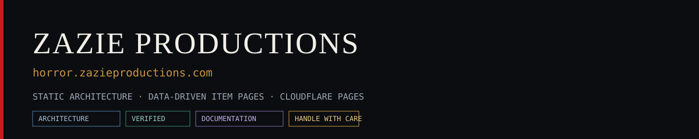
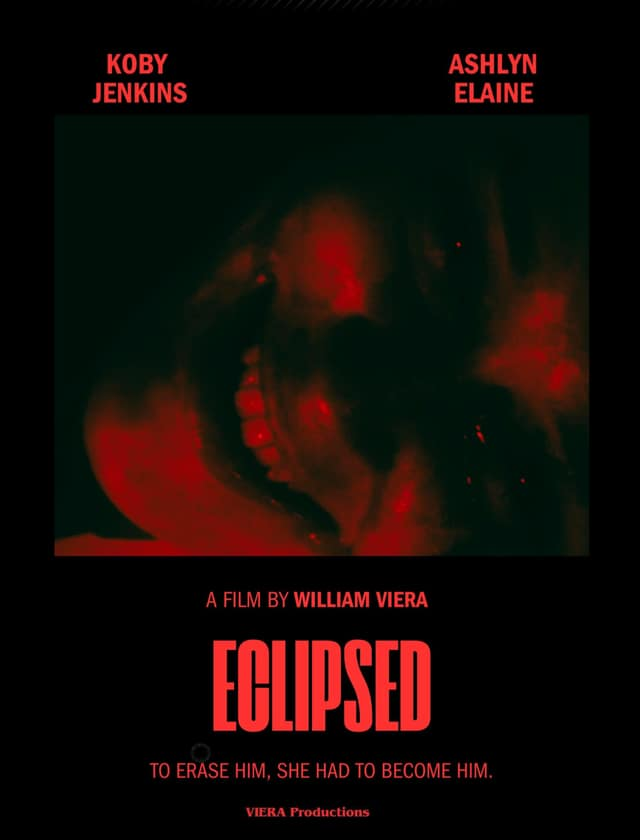
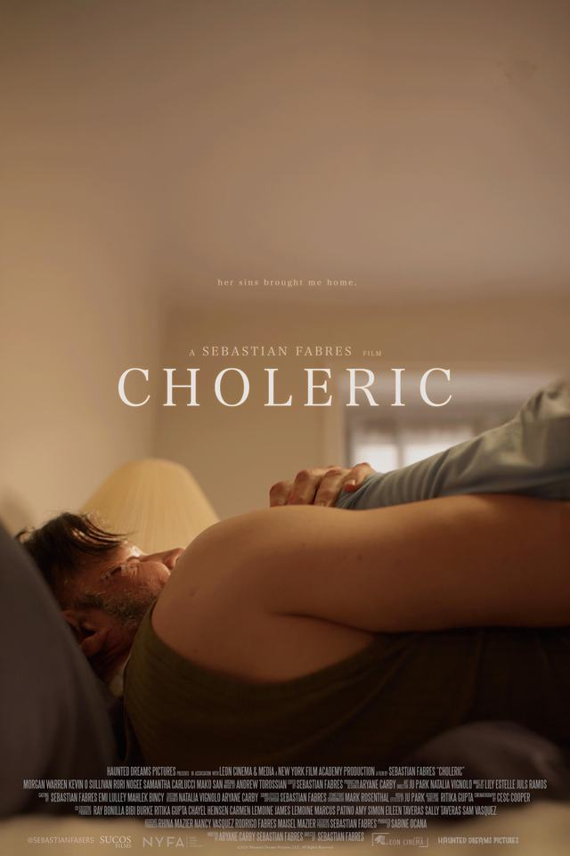
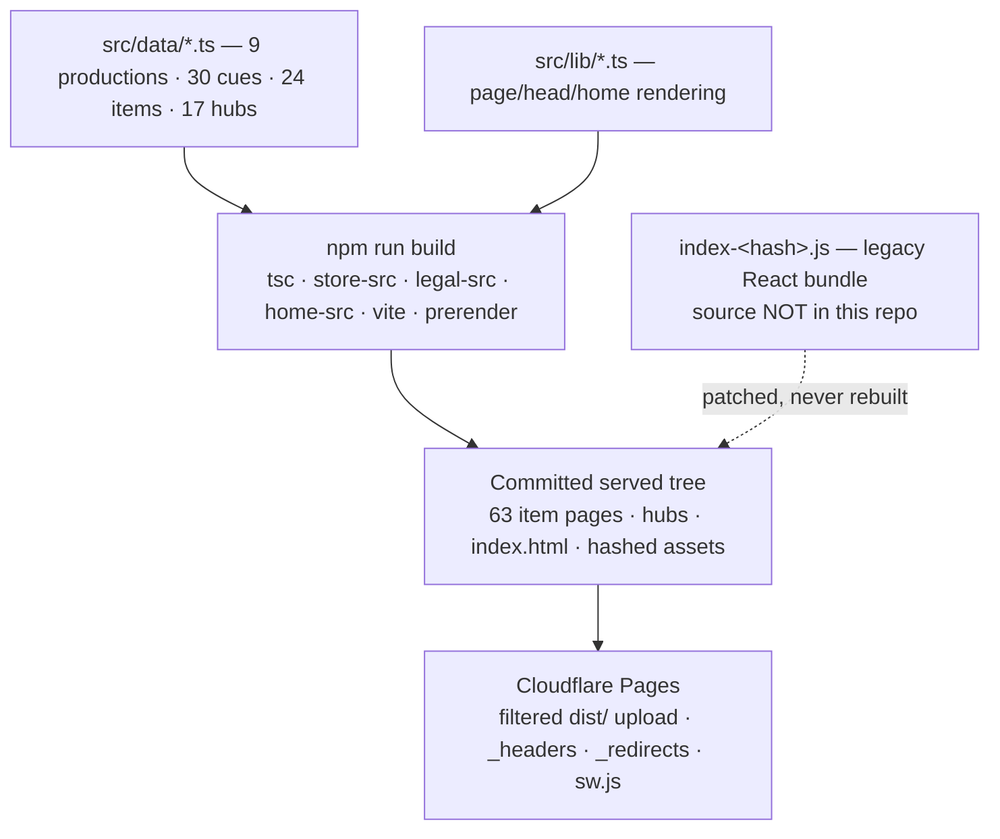

<div align="center">



**The horror-facing portfolio of Zazie Productions — the scoring and sound-design studio of composer Zazie Kanwar-Torge.**

An immersive static web environment for psychological horror scoring, experimental
composition and dark audiovisual work: horror cinema × experimental music × sound
design × interactive web technology.

[](https://horror.zazieproductions.com)
[](#project-overview)
[](#maintenance-and-known-limitations)

[](#technology-stack)
[](#technology-stack)
[](#architecture-at-a-glance)
[](#cloudflare-deployment)
[](https://github.com/zazieproductions/zazie-horror-portfolio/actions/workflows/deploy.yml)

[](docs/architecture/overview.md)
[](docs/development/getting-started.md)
[](docs/deployment/cloudflare.md)
[](CONTRIBUTING.md)
[](AGENTS.md)

</div>

> [!NOTE]
> **Read this first if you are changing anything.** This repository contains
> multiple generations of site infrastructure. The homepage's React bundle has
> **no source in this repository**; newer TypeScript/Vite code generates the
> 63 item pages; the catalogue and legal documents have their own pipelines.
> Generated output is committed and never hand-edited. The map is in
> [docs/architecture/system-map.md](docs/architecture/system-map.md), the
> rules in [AGENTS.md](AGENTS.md).

---

## Navigation

| Start here | Go deeper |
|---|---|
| [Project overview](#project-overview) · [Live experience](#live-experience) · [Key features](#key-features) | [Architecture](docs/architecture/overview.md) · [System map](docs/architecture/system-map.md) |
| [Quick start](#quick-start) · [Local development](#local-development) · [Build & verification](#build-and-verification) | [Development docs](docs/development/getting-started.md) · [Testing](docs/development/testing.md) |
| [Cloudflare deployment](#cloudflare-deployment) · [Testing & QA](#testing-and-quality-assurance) | [Deployment docs](docs/deployment/cloudflare.md) · [Verification](docs/deployment/verification.md) |
| [Content & media](#content-and-media-architecture) · [Contributing](#contributing) | [Content management](docs/features/content-management.md) · [Full docs index](docs/README.md) |

---

## Project overview

`horror.zazieproductions.com` is simultaneously a client-facing portfolio, an
archive of record for productions/cues/catalogue items, and — unusually — its
own deployment artifact: the served static tree is committed at the repository
root and uploaded (filtered) to Cloudflare Pages by GitHub Actions.

| Verified fact | Value | Source |
|---|---|---|
| Hub routes | 17 (incl. `/`) | `src/data/hubs.ts` |
| Productions / cues / catalogue items | 9 / 30 / 24 | `src/data/{productions,cues,releases}.ts` |
| Generated item pages | 63 | `work/`, `reel/`, `store/` flat files |
| Sitemap URLs | 80 | `sitemap.xml` |
| Backend / runtime dependencies | none / none | `package.json` |

> [!WARNING]
> Older prose in this repo's history cites 19 hubs, 65 items, 32 cues and
> 84 URLs. Those described an earlier tree. Re-derive counts from `src/data/`
> before quoting them — see [known limitations](docs/project/known-limitations.md).

## Live experience

**<https://horror.zazieproductions.com>**

| Route | Role |
|---|---|
| `/` | Portfolio: productions, 30-cue showreel, film samples, press, inquiry (`mailto:` handoff) |
| `/work` `/reel` `/store` | Hubs for productions, cues, catalogue (checkout delegated to marketplaces) |
| `/hire-a-composer` `/sound-design` `/game-scoring` `/how-to-hire-a-horror-composer` | Commissioning pages |
| `/process` `/faq` `/legal` `/terms` `/privacy` `/licensing` `/purchases` `/accessibility` `/sitemap` | Process, trust and legal documents |
| any unknown path | `404.html` — "Signal Lost", served with a real HTTP 404 |

Every route is a real static path. There is deliberately **no SPA fallback**.

| | | | |
|---|---|---|---|
|  |  |  |  |

*Film key art © the respective productions.*

## Key features

- **Data-driven item archive** — 63 pages generated from typed data with
  per-page `<head>`, canonical and JSON-LD in the first byte; readable with
  JavaScript off.
- **Showreel** — 30 cues with dedicated pages, native playback and an
  on-demand in-browser ZIP download; no second hosted archive.
- **Listen-first, privacy-structural** — no backend, no cookies set by the
  site, no accounts; the only remote script is the disclosed, cookieless
  Cloudflare Web Analytics beacon (see `/privacy`).
- **Catalogue without a shop** — 24 records linking to Bandcamp / itch.io /
  Gumroad / eBay; no invented prices or stock claims in schema.
- **Self-verifying build** — the pipeline audits its own links, headers,
  forms, routes, sitemap and coverage, and CI rejects stale generated output.

## Architecture at a glance

Three pipelines, one served tree. Full diagrams: [system map](docs/architecture/system-map.md).



> [!CAUTION]
> Do not move, rename or "tidy" production files for visual neatness.
> Routing, hashing, precaching and the stale-output CI gate all depend on
> current paths. Relocations require the manifest process used in
> [docs/archive/RELOCATION-MANIFEST.md](docs/archive/RELOCATION-MANIFEST.md).

## Technology stack

TypeScript (strict) + Vite 6 for the item bundle · vanilla ES modules for
documents/catalogue · Bash + Python 3 build scripts · hand-written service
worker · Cloudflare Pages (`_headers`/`_redirects`) · Node.js ≥ 20.19
(CI: 22). Build-only dependencies only; **zero runtime dependencies**.

## Project structure

```text
.
├── index.html · index-<hash>.{js,css}   # homepage + LEGACY bundle (no source in repo)
├── 404.html · sw.js · _headers · _redirects · robots.txt · sitemap.xml
├── src/            # EDITABLE: data/ (routes & content) · lib/ (rendering) · item/ · inquiry/
├── scripts/        # EDITABLE: build pipeline (prerender, sitemap, llms, verify…)
├── tools/          # EDITABLE: checks + tests (check-links/headers/forms, *.test.mjs)
├── store-src/ · legal-src/ · home-src/   # EDITABLE pipeline sources
├── work/ reel/ store/                    # GENERATED item pages — never hand-edit
├── audio/ images/ fonts/                 # static media (30 showreel MP3s)
├── docs/           # authoritative engineering documentation (start: docs/README.md)
├── AGENTS.md · CONTRIBUTING.md · SECURITY.md · CHANGELOG.md
├── PERFORMANCE.md LEGAL.md RATIFY.md SEO-DOSSIER.md SITEMAP.md STORE.md ITEM-URLS.md
│                   # dated implementation records — living project memory, kept at root
└── docs/archive/   # dated dossiers/audits/proposals (not current instructions)
```

## Quick start

```bash
git clone https://github.com/zazieproductions/zazie-horror-portfolio.git
cd zazie-horror-portfolio
npm ci            # Node >= 20.19; also needs Bash + Python 3
npm run build     # full pipeline — rewrites generated output; review `git status`
npm run serve     # http://localhost:8080 — mirrors Cloudflare routing locally
```

## Local development

Edit `src/`, `store-src/`, `legal-src/` or `home-src/` → `npm run build` →
refresh. There is no whole-site hot reload; `server.mjs` deliberately mirrors
production routing/headers so local behaviour is evidence, not approximation.
Details: [local development](docs/development/local-development.md).

> [!TIP]
> Fresh clone: run `npm run build` **before** `npm test` — two test files
> import compiled output from `build/`. CI runs the complete build twice and
> rejects generated-output drift; the verified 2026-10-29 repair baseline is in
> [testing](docs/development/testing.md).

## Build and verification

| Command | Proves |
|---|---|
| `npm run build` | Whole pipeline incl. verify/headers/links/forms/sitemap gates |
| `npm run typecheck` | Strict TypeScript over `src/` |
| `npm test` | 15 `node --test` suites in `tools/` |
| `npm run verify` · `check:links` · `check:forms` · `check:headers` | Page structure · link integrity · form labelling · header policy |
| `npm run check:docs` | Markdown links in this README + `docs/` resolve |
| `npm run lint:slop` | aislop quality gate (`.aislop/` policy + baseline) |

> [!IMPORTANT]
> Scripts that rewrite committed HTML/assets: `build`, `prerender`,
> `generate:sitemap`, `generate:llms`. Never run them casually and commit
> the churn without understanding the diff.

## Content and media architecture

Content is code: productions in `src/data/productions.ts`, cues in
`src/data/cues.ts` (+ `audio/track-NN.mp3`), catalogue in
`src/data/releases.ts`. Recipes and guardrails (credits must be sourced;
no invented facts): [content management](docs/features/content-management.md).

## Cloudflare deployment

GitHub Actions → filtered `dist/` (`scripts/build-deploy-dir.mjs`) → Wrangler
Pages upload → live route audit. Secrets by name only:
`CLOUDFLARE_API_TOKEN`, `CLOUDFLARE_ACCOUNT_ID`. "Actions green" ≠ "site
updated": the four-level verification model and failure decision tree are in
[deployment verification](docs/deployment/verification.md).

## Testing and quality assurance

See [testing](docs/development/testing.md) for the full matrix and the
recorded 2026-10-29 baseline. Quality docs: [accessibility](docs/quality/accessibility.md) ·
[performance](docs/quality/performance.md) · [security](docs/quality/security.md) · [SEO](docs/quality/seo.md).

## Security and accessibility

CSP/header policy is single-sourced in `tools/headers.mjs` and build-checked
against `_headers`; vulnerability reporting in [SECURITY.md](SECURITY.md).
Accessibility target is WCAG 2.2 AA (partially conformant, gaps named on
`/accessibility`) — patterns in [accessibility](docs/quality/accessibility.md).

## Documentation index

[docs/README.md](docs/README.md) is the map: architecture · development ·
deployment · features · quality · project · archive, plus the
single-source-of-truth table that prevents documentation drift.

## Development workflow

Branch → smallest change → build + checks → commit source with regenerated
output → PR (template provided) → `deploy.yml` validates; merge to `main`
deploys. Agents: [AGENTS.md](AGENTS.md) is mandatory reading.

## Contributing

[CONTRIBUTING.md](CONTRIBUTING.md). This is a single-maintainer,
independently run project — no corporate process theatre, but the validation
bar is real.

## Maintenance and known limitations

[Maintenance](docs/project/maintenance.md) · [known limitations](docs/project/known-limitations.md)
(legacy bundle source absence, test/build ordering, generated-output
release contract) · open human decisions in [RATIFY.md](RATIFY.md).

## Credits, copyright and licensing

Composer & studio: **Zazie Kanwar-Torge — Zazie Productions LLC**.
Production records credit roles exactly as sourced (per-page source links;
e.g. UNSEEN's IMDb composer is Steve Merlo — recorded, not claimed).
Press/links: [IMDb](https://www.imdb.com/name/nm17333332) ·
[Bandcamp](https://zazieproductions.bandcamp.com) ·
[YouTube](https://youtube.com/@zazieproductions) ·
[Spotify](https://open.spotify.com/artist/4UOgvZEOo7xBhFBjJvlMm0).

**All rights reserved (`UNLICENSED`).** No open-source license is granted for
code, design, copy, artwork or audio in this repository. Music licensing:
[`/licensing`](https://horror.zazieproductions.com/licensing). Terms:
[`/terms`](https://horror.zazieproductions.com/terms) · Privacy:
[`/privacy`](https://horror.zazieproductions.com/privacy). Film key art
remains the property of the respective productions.

<details>
<summary>Historical detail preserved from the previous README</summary>

The pre-2026-10-29 README (568 lines) documented, among other things, the
reconstructed legacy component map, per-system audio tables, cache-policy
tables and the aislop gate in full. That material now lives, corrected to
verified counts, in `docs/` (audio: `docs/architecture/audio-systems.md`;
headers/caching: `docs/quality/security.md` + `_headers` itself; aislop:
`.aislop/config.yml`). The full old text remains in git history
(`git log --follow -- README.md` — the version before this overhaul).

</details>
