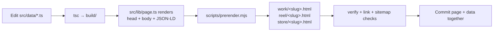

# Rendering pipeline

`npm run build` is a long, ordered, **side-effecting** pipeline: it rewrites
committed HTML, regenerates `sitemap.xml` / `llms*.txt`, rehashes bundles and
bumps references. Run it deliberately, then review `git status`.

## Sequence (from `package.json`, in order)

| # | Step | Effect |
|---|---|---|
| 1 | `tsc` | Type-checks and emits `src/` → `build/` (tests and prerender import from `build/`) |
| 2 | `scripts/sync-static-seo.mjs` | Syncs static SEO into committed pages |
| 3 | `./store-src/build.sh` | Rebuilds catalogue hub + hashed `store-*` assets |
| 4 | `./legal-src/build.sh` | Rebuilds document hubs + hashed `legal-*` assets |
| 5 | `scripts/build-inquiry.mjs` | Builds inquiry bundle (`inquiry-<hash>.js`) |
| 6 | `scripts/build-reel-download.mjs` | Builds reel-download bundle |
| 7 | `home-src/build.mjs` | Patches homepage DOM + legacy bundle (rehashes `index-<hash>.js`) |
| 8 | `scripts/sync-commission.mjs` (+ `--check`) | Syncs/verifies commission copy from `src/data/commission.ts` |
| 9 | `tools/route-aliases.mjs` | Regenerates/verifies hub root twins |
| 10 | `scripts/generate-sitemap.mjs` | Regenerates `sitemap.xml` from route registry |
| 11 | `scripts/generate-llms.mjs` | Regenerates `llms.txt`, `llms-full.txt` |
| 12 | `vite build` | Builds `src/item/main.ts`; exports only hashed `item-*` CSS/JS to root (see `vite.config.ts`) |
| 13 | `scripts/prerender.mjs` | Writes 63 flat item pages; rewrites homepage `<head>` + poster cards |
| 14 | `scripts/verify.mjs`, `tools/check-headers.mjs`, `tools/check-links.mjs`, `tools/check-forms.mjs` | Structural, header-policy, link and form gates |
| 15 | `tools/route-aliases.mjs --check`, `tools/generate-redirects.mjs --check`, `tools/check-sitemap.mjs`, `tools/index-coverage.mjs --check` | Route/redirect/sitemap/coverage gates |
| 16 | `scripts/normalize-site-copy.mjs` | Copy normalisation (e.g. em-dash replacement in public text) |

## Content-to-page flow

> [!IMPORTANT]
> Prerender requires the Vite manifest (`build/item-assets/item-manifest.json`).
> Running `node scripts/prerender.mjs` standalone before `vite build` fails by
> design. Use `npm run build`, or `--only=<slug>` for single-item review after
> a full build.

## Environment note (observed 2026-10-29)

On this checkout, `npm run build` **passes** but rehashes several bundles
(`index-*`, `item-*`, `legal-*`, `inquiry-*`) versus the committed hashes —
i.e. the committed output is not byte-reproducible in every environment.
Do not commit rehash churn unless your change intends it; `deploy.yml`'s
stale-output gate compares against *its* runner's build. See
[known limitations](../project/known-limitations.md).
