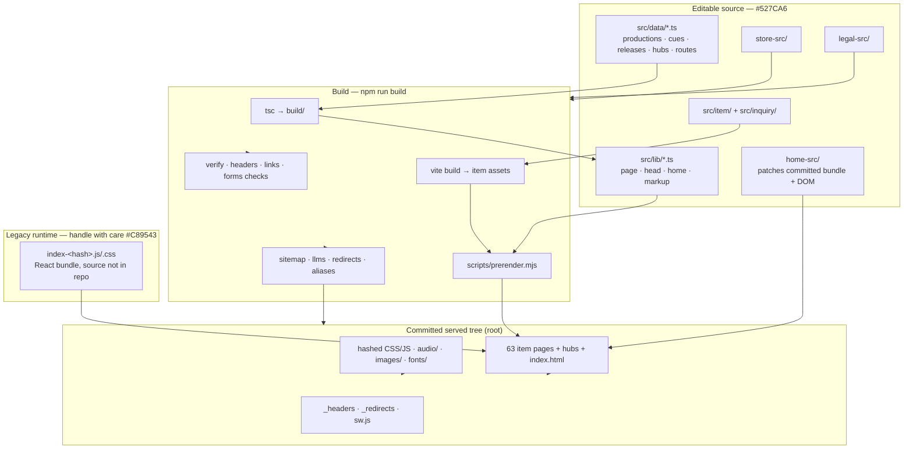

# System map

## Active source, generated output, legacy runtime — do not confuse them

| Class | Paths | Editable? |
|---|---|---|
| **Typed source** | `src/data/*.ts`, `src/lib/*.ts`, `src/item/`, `src/inquiry/` | Yes — primary edit surface |
| **Pipeline sources** | `store-src/`, `legal-src/`, `home-src/`, `src/reel-download/` | Yes |
| **Build / validation tooling** | `scripts/*.mjs`, `tools/*.mjs`, `server.mjs` | Yes |
| **Edge configuration** | `_headers`, `_redirects`, `sw.js`, `robots.txt` | Yes, with care (see [routing](routing.md)) |
| **Generated, committed** | `work/*.html`, `reel/*.html`, `store/*.html` (item pages), `sitemap.xml`, `llms.txt`, `llms-full.txt`, hashed bundles (`item-*`, `legal-*`, `store-*`, `inquiry-*`, `reel-download-*`) | **Never hand-edit** — change source, run `npm run build` |
| **Generated hub output** | `store/index.html` + `store.html` twin; legal/document `<slug>/index.html` + root twins | **Never hand-edit** — sources are `store-src/`, `legal-src/` |
| **Legacy runtime (no source)** | `index.html`, `index-<hash>.js`, `index-<hash>.css`, `index.html`'s prerendered DOM | The React app that produced the bundle is **not reconstructible from this tree**. `home-src/build.mjs` patches the committed bundle/DOM; it does not rebuild the app |
| **Committed hub pages (no generator)** | e.g. `work/index.html`, `reel/index.html`, `process/`, `game-scoring/` directory pages + root `.html` twins | Hand-maintained HTML; keep directory page and root twin byte-identical (`tools/route-aliases.mjs` checks this) |
| **Static media** | `audio/`, `images/`, `fonts/`, root uploads (`Eclipsed.png`, `The Dark Awaits.png`, …) | Assets; root PNG/WAV/AIF files are provenance uploads, not all are served |
| **Records & docs** | root `*.md` records, `docs/` | Documentation |
| **Ignored build output** | `build/`, `node_modules/`, `dist/` | Never commit (`.gitignore`) |

> [!CAUTION]
> `deploy.yml` fails if committed generated output differs from what
> `npm run build` produces. Hand-editing generated HTML therefore breaks CI
> even when the edit "looks right".

## Diagram

## Integration boundaries

- **Homepage head ordering:** `home-src/build.mjs` patches the document first;
  `scripts/prerender.mjs` then calls `home-src/document.mjs` to regenerate SEO
  and posters and reinstall the mobile overrides last. That final render is
  pure and byte-idempotent; CI proves it with two complete builds.
- **Cloudflare Pages** serves `dist/` assembled by
  `scripts/build-deploy-dir.mjs` (root minus tooling/sources/markdown).
- **Marketplaces** own price/stock/checkout; item pages link out and omit
  mutable price/stock schema.
- **YouTube / Drive / Bandcamp** embeds are lazy-loaded and CSP-allowlisted
  per host in `tools/headers.mjs`.
