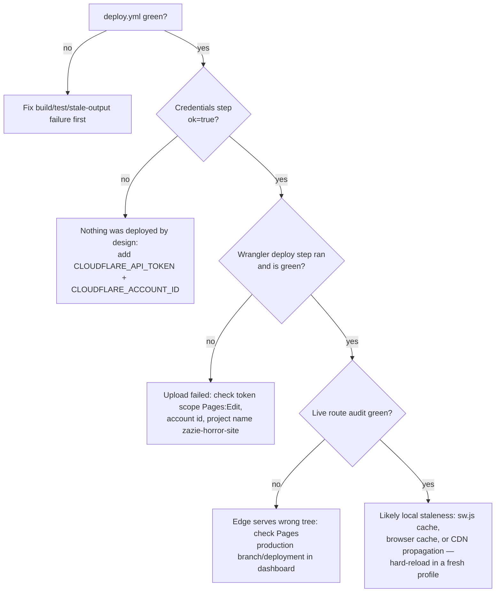

# Deployment verification — four different "successes"

| Layer | Evidence | Not proved by |
|---|---|---|
| 1. GitHub Actions success | `deploy.yml` run green (build, tests, stale-output gate) | Anything about the edge |
| 2. Cloudflare upload success | wrangler step green; deployment listed in Pages dashboard | That the domain serves it |
| 3. Cloudflare deployment success | Deployment marked active for `main` / production | That every route is correct |
| 4. Observable production correctness | Live route audit + spot checks below | — (this is the bar) |

## "Actions is green but the site hasn't updated" — decision tree



## Post-deploy checklist

```bash
node tools/live-route-audit.mjs https://horror.zazieproductions.com
curl -sI https://horror.zazieproductions.com/work | head -5
curl -s https://horror.zazieproductions.com/sitemap.xml | grep -c '<url>'   # expect 80
```

Plus: open `/`, one production, one cue, one catalogue item and `/store` in a
fresh browser profile; confirm the showreel plays and no CSP errors appear.
